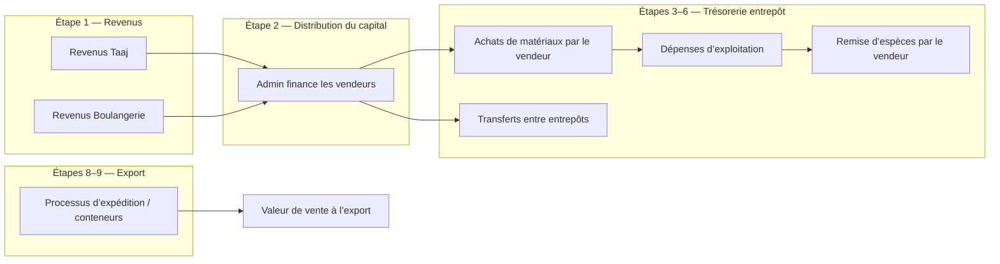

# Viaduc ERP — Référence Finance & Tableau de bord

Ce document explique **chaque carte et section où de l’argent (DJF) apparaît** côté administrateur, comment chaque valeur est calculée, et quelles données saisir pour la modifier.

Toutes les valeurs monétaires utilisent le **Franc djiboutien (DJF)**.

---

## Flux de l’argent dans l’activité



| Concept | Où le saisir | Collection Firestore |
|--------|--------------|----------------------|
| Revenus Taaj / Boulangerie | Grand livre financier → Revenus (Taaj & Boulangerie) | `moneyTransfers` |
| Capital envoyé à un vendeur | Utilisateurs / Finance → Financer un vendeur | `sellerFunding` |
| Achat de matériaux (coût) | Achat rapide vendeur | `entries` (+ `inventory`) |
| Dépense d’exploitation | Grand livre financier → Dépenses | `expenses` |
| Salaire | Grand livre financier → Salaires | `salaries` |
| Espèces remises par le vendeur | Vendeur → Suivi de l’argent | `moneySubmissions` |
| Argent déplacé entre entrepôts | Grand livre financier → Transferts entrepôts | `warehouseTransfers` |
| Export / expédition | Logistique commerciale → Processus d’expédition | `containers` |

---

## 1. Tableau de bord admin — Vue d’ensemble exécutive

**Page :** `/admin`  
**API :** `GET /api/analytics/dashboard` → objet `executive`

Le tableau de bord comporte **4 rangées**. Seules certaines cartes affichent de l’argent ; les cartes en poids uniquement sont mentionnées brièvement.

### Rangée 1 — Soldes de trésorerie par entrepôt + dépenses totales

#### Balance Warehouse **TORABORA** / **PK12** / **JAJAB**

| Champ | Valeur |
|-------|--------|
| **Ce qu’elle affiche** | **Espèces restantes** dans cet entrepôt pour acheter des matériaux et payer les coûts locaux |
| **Unité** | DJF |
| **Peut être négatif** | Oui — si les dépenses dépassent le financement |

**Formule (par entrepôt) :**

```
Solde =
  Capital versé aux vendeurs de cet entrepôt
  − Achats effectués dans cet entrepôt
  − Dépenses d’exploitation rattachées à cet entrepôt
  − Espèces remises par les vendeurs de cet entrepôt
  + Transferts entrepôt ENTRANTS
  − Transferts entrepôt SORTANTS
```

**En termes de code :**

```
capitalGiven   = SUM(sellerFunding.amount)     pour les vendeurs où user.warehouseId = cet entrepôt
purchases      = SUM(entries.collectedMoney)   où entry.warehouseId = cet entrepôt
whExpenses     = SUM(expenses.amount)          où expense.warehouseId = cet entrepôt
submitted      = SUM(moneySubmissions.amount)  pour les vendeurs de cet entrepôt
transfersIn    = SUM(warehouseTransfers.amount) où toWarehouseId = cet entrepôt
transfersOut   = SUM(warehouseTransfers.amount) où fromWarehouseId = cet entrepôt

warehouseCashBalance = capitalGiven − purchases − whExpenses − submitted + transfersIn − transfersOut
```

**Exemple :** L’admin envoie 1 000 000 DJF à un vendeur à Pk12, le vendeur achète du cuivre pour 400 000 DJF et remet 100 000 DJF → solde Pk12 ≈ **500 000 DJF**.

**Important :** Il s’agit de la **position de trésorerie**, pas du poids ou de la valeur du stock.

---

#### **Expense** (4ᵉ carte, rangée 1)

| Champ | Valeur |
|-------|--------|
| **Ce qu’elle affiche** | Total des **dépenses d’exploitation + salaires** de l’entreprise (tous entrepôts + siège) |
| **Unité** | DJF |
| **Couleur** | Rouge |

**Formule :**

```
Carte Dépenses = SUM(toutes expenses.amount) + SUM(tous salaries.amount)
```

**N’inclut PAS :**

- Les coûts d’achat de matériaux (`entries.collectedMoney`) — ils réduisent le solde entrepôt, pas cette carte
- Les frais de processus d’expédition (`containers.totalExpense`) — ils apparaissent dans le Grand livre financier et le Bénéfice net, pas sur cette carte du tableau de bord

**Où saisir les données :** Grand livre financier → onglet Dépenses, onglet Salaires.

---

### Rangée 2 — Poids des matériaux + revenus

#### WHSE **TORABORA** / **PK12** / **JAJAB** (3 cartes)

| Champ | Valeur |
|-------|--------|
| **Ce qu’elle affiche** | **Poids (kg)** du matériau sélectionné actuellement en stock dans cet entrepôt |
| **Unité** | kg (pas DJF) |
| **Menu déroulant** | Choisir le matériau ; par défaut = matériau avec le plus de poids dans cet entrepôt |

**Formule :**

```
poids = SUM(inventory.weight)
        où inventory.warehouseId = cet entrepôt
          ET inventory.productId = matériau sélectionné
          ET status = in_stock (implicite dans les lignes d’inventaire actives)
```

**Où saisir les données :** Achat rapide vendeur (crée `entries` + `inventory`), ou Inventaire → Transfert de stock.

---

#### **Income — Total / Transfers** (4ᵉ carte, rangée 2)

| Champ | Valeur |
|-------|--------|
| **Ce qu’elle affiche** | Argent collecté provenant des sources de revenus de l’activité |
| **Unité** | DJF |
| **Menu déroulant** | ALL · Taaj · Bakeri |

**Formule selon le filtre :**

| Filtre | Calcul |
|--------|--------|
| **ALL** | Valeur de vente à l’export + revenus Taaj + revenus Boulangerie |
| **Taaj** | `SUM(moneyTransfers.amount)` où `type = 'taaj'` |
| **Bakeri** | `SUM(moneyTransfers.amount)` où `type = 'bakery'` |

```
taajIncome    = SUM(moneyTransfers.amount) où type = 'taaj'
bakeryIncome  = SUM(moneyTransfers.amount) où type = 'bakery'
exportRevenue = SUM(containers.sellingValue)

ALL = exportRevenue + taajIncome + bakeryIncome
```

**Où saisir les données :**

- Taaj / Boulangerie → Grand livre financier → Revenus (Taaj & Boulangerie)
- Partie export → Logistique commerciale → Processus d’expédition → **Valeur de vente**

**Note :** Avec le filtre **Taaj** ou **Bakeri**, seule cette source est affichée. **ALL** inclut aussi les revenus d’export des conteneurs expédiés.

---

### Rangée 3 — Graphiques (principalement du poids, pas de l’argent)

#### Suivi des mouvements d’entrepôt (Warehouse Movement Tracking)

| Champ | Valeur |
|-------|--------|
| **Ce qu’il affiche** | **kg de matériaux entrant** dans chaque entrepôt par période |
| **Unité** | kg |
| **Périodes** | 24J · 7J · 30J · 90J |

**Formule (par entrepôt, par jour/semaine) :**

```
poids des mouvements = SUM(entry.weight) pour les achats dans cet entrepôt sur la période
                     + SUM(transfer.weight) pour les transferts de stock reçus dans cet entrepôt sur la période
```

Utilise uniquement `entries` et `transfers` — **pas** les lignes `inventory` (pour éviter le double comptage, car chaque achat crée déjà une entrée).

---

#### Aperçu du stock (donut + liste)

| Champ | Valeur |
|-------|--------|
| **Chiffre central** | Poids total du stock (tous matériaux), en **T** (tonnes) ou **KG** |
| **Donut / liste** | Part de chaque matériau par poids |
| **Filtre entrepôt** | Tous · TORABORA · PK12 · JAJAB |
| **Statut** | Stable / Actif / Faible (selon des seuils de poids, pas d’argent) |

**Formule :**

```
poidsTotal = SUM(inventory.weight) pour le(s) entrepôt(s) filtré(s)
par matériau = SUM(inventory.weight) groupé par productId
```

**Seuils de statut :**

| Statut | Condition |
|--------|-----------|
| Faible (Low) | poids < 500 kg |
| Actif (Active) | 500 kg ≤ poids < 2 000 kg |
| Stable | poids ≥ 2 000 kg |

---

## 2. Grand livre financier (page admin associée)

**Page :** `/admin/finance`  
**API :** `GET /api/finance/dashboard`

Ces cartes utilisent les mêmes données sous-jacentes mais répondent à des questions **à l’échelle de l’entreprise**.

### Solde total (grand chiffre en haut)

| Champ | Valeur |
|-------|--------|
| **Ce qu’il affiche** | Argent encore disponible pour envoyer aux entrepôts après les revenus et distributions |
| **Aussi appelé** | Capital disponible |

**Formule :**

```
Solde total = Revenus (Taaj + Boulangerie) − Capital distribué aux vendeurs

incomeTotal       = taajIncome + bakeryIncome
totalDistributed  = SUM(sellerFunding.amount)
availableCapital  = incomeTotal − totalDistributed
```

Ce n’est **pas** la même chose que les cartes de solde entrepôt. C’est le **pool du gestionnaire** avant d’envoyer de l’argent aux vendeurs.

---

### Cartes KPI (3 cartes sous l’en-tête)

#### Revenus (Taaj + Boulangerie)

```
incomeTotal = SUM(moneyTransfers.amount) où type in ('taaj', 'bakery')
```

Tendance % = variation mois par mois de la courbe des revenus du graphique financier.

---

#### Dépenses totales

```
Dépenses totales = SUM(expenses.amount) + SUM(containers.totalExpense)
```

Inclut :

- Toutes les dépenses d’exploitation (transport, carburant, porteur, etc.)
- Les **frais de processus d’expédition** de la Logistique commerciale

N’inclut **pas** les salaires dans le libellé de cette carte — les salaires sont soustraits séparément dans le Bénéfice net.

---

#### Bénéfice net

```
Bénéfice net =
  Valeur de vente à l’export (containers.sellingValue)
  − Coût d’achat des matériaux (entries.collectedMoney)
  − Dépenses d’exploitation (expenses.amount)
  − Salaires (salaries.amount)
  − Frais d’expédition (containers.totalExpense)
```

C’est le **véritable compte de résultat (P&L)** de l’activité ferraille/export : les revenus proviennent des **ventes à l’export**, pas des revenus Taaj/Boulangerie (ces revenus servent de capital pour acheter les matériaux).

---

### Graphique statistiques (Revenus vs Dépenses)

Buckets mensuels sur les 12 derniers mois :

| Courbe | Inclut |
|--------|--------|
| **Revenus** | Transferts Taaj + Boulangerie + valeur de vente à l’export |
| **Dépenses** | Dépenses d’exploitation + salaires + coûts d’achat + frais d’expédition |

---

### Répartition des coûts (Achats · Dépenses · Salaires · Expédition)

Répartition type camembert des **coûts** utilisée pour la rentabilité :

| Part | Source |
|------|--------|
| Achats | `entries.collectedMoney` |
| Dépenses | `expenses.amount` |
| Salaires | `salaries.amount` |
| Expédition | `containers.totalExpense` |

---

## 3. Gestion des stocks — Carte Coût des matériaux

**Page :** `/admin/inventory` (section aperçu)  
**Pas de DJF sur le tableau de bord principal**, mais lié à l’argent :

| Champ | Valeur |
|-------|--------|
| **Ce qu’elle affiche** | Total de l’**argent dépensé** pour acquérir les matériaux actuellement en stock |
| **Unité** | DJF |
| **Menu déroulant** | Tous les entrepôts · TORABORA · PK12 · JAJAB |

**Formule :**

```
Coût des matériaux = SUM(inventory.value)
                     pour les lignes in_stock
                     filtrées par entrepôt sélectionné
```

La `value` de chaque ligne d’inventaire est définie lors de l’achat par le vendeur (= `collectedMoney` de cet achat).

Cela répond à : *« Combien d’argent est immobilisé dans le stock au sol ? »* — différent du **solde de trésorerie** entrepôt (qui soustrait les achats du financement).

---

## 4. Comparaison rapide — que signifie chaque « solde » ?

| Libellé | Signification | Usage typique |
|---------|---------------|---------------|
| **Balance Warehouse (Rangée 1 du tableau de bord)** | Espèces restantes dans un entrepôt après financement, achats, dépenses, remises, transferts | Peut-on encore acheter des matériaux là-bas ? |
| **Solde total (Grand livre financier)** | Revenus Taaj + Boulangerie moins l’argent déjà envoyé aux vendeurs | Combien l’admin peut-il encore distribuer ? |
| **Solde vendeur (Tableau de bord vendeur)** | Financement − achats − espèces remises pour **un vendeur** | Ce vendeur peut-il faire un autre achat ? |
| **Coût des matériaux (Inventaire)** | Coût d’achat du stock physique en main | Combien d’argent est dans les matériaux stockés ? |
| **Bénéfice net (Grand livre financier)** | Ventes à l’export moins tous les coûts de l’activité | L’activité d’export est-elle rentable ? |

---

## 5. Côté vendeur (pour contexte)

Lorsqu’un vendeur achète un matériau, **`collectedMoney`** est calculé ainsi :

```
collectedMoney = poids × pricePerKg
```

`pricePerKg` provient des **Tarifs** admin (détail ou gros).

Solde vendeur :

```
solde = fundedBalance − totalSpent − totalSubmitted
```

Quand le solde est vide, les achats peuvent quand même être enregistrés ; le solde courant dans les tableaux de transactions affiche un montant **négatif**.

---

## 6. Rapport bi-hebdomadaire (page Rapports)

**Page :** `/admin/reports`  
**Notification :** Icône cloche admin lorsque 2 jours se sont écoulés depuis le dernier téléchargement

| Section | Calcul |
|---------|--------|
| Matériaux collectés | `SUM(entry.weight)` et `SUM(entry.collectedMoney)` par matériau, 2 derniers jours, tous entrepôts |
| Solde entrepôt | Même formule que le solde de trésorerie entrepôt (Rangée 1 du tableau de bord) |

---

## 7. Comportement avec une base de données vide

Après suppression des données d’exemple (`npm run clear-data` dans `backend/`) :

- Toutes les cartes monétaires affichent **0 DJF** jusqu’à la saisie de données réelles
- Les cartes de solde entrepôt restent à **0** tant que vous n’**financez pas un vendeur** et/ou n’enregistrez pas d’achats
- Les revenus restent à **0** tant que vous n’ajoutez pas de revenus Taaj/Boulangerie ou de valeurs de vente à l’export
- Les cartes de poids (rangée 2) restent à **0 kg** tant que les achats ne créent pas d’inventaire

**Ordre recommandé pour saisir les données réelles :**

1. **Tarifs** — définir le prix au kg pour chaque matériau  
2. **Revenus (Taaj & Boulangerie)** — enregistrer le capital entrant  
3. **Financer un vendeur** — envoyer de l’argent aux vendeurs par entrepôt  
4. **Achat rapide** — les vendeurs achètent des matériaux (met à jour poids + solde entrepôt)  
5. **Dépenses / Salaires** — au fur et à mesure  
6. **Processus d’expédition** — lors de l’export (met à jour revenus export + frais d’expédition)

---

## 8. Fichiers sources (pour les développeurs)

| Zone | Frontend | Backend |
|------|----------|---------|
| Cartes Vue d’ensemble exécutive | `frontend/src/pages/admin/AdminDashboard.jsx` | `backend/src/controllers/analytics.controller.js` |
| Grand livre financier | `frontend/src/pages/admin/FinancePage.jsx` | `backend/src/controllers/finance.controller.js` |
| Coût des matériaux (Inventaire) | `frontend/src/components/inventory/InventoryOverview.jsx` | collection `inventory` (champ `value`) |
| Solde vendeur | `frontend/src/pages/seller/SellerDashboard.jsx` | `getSellerDashboard` dans `analytics.controller.js` |
